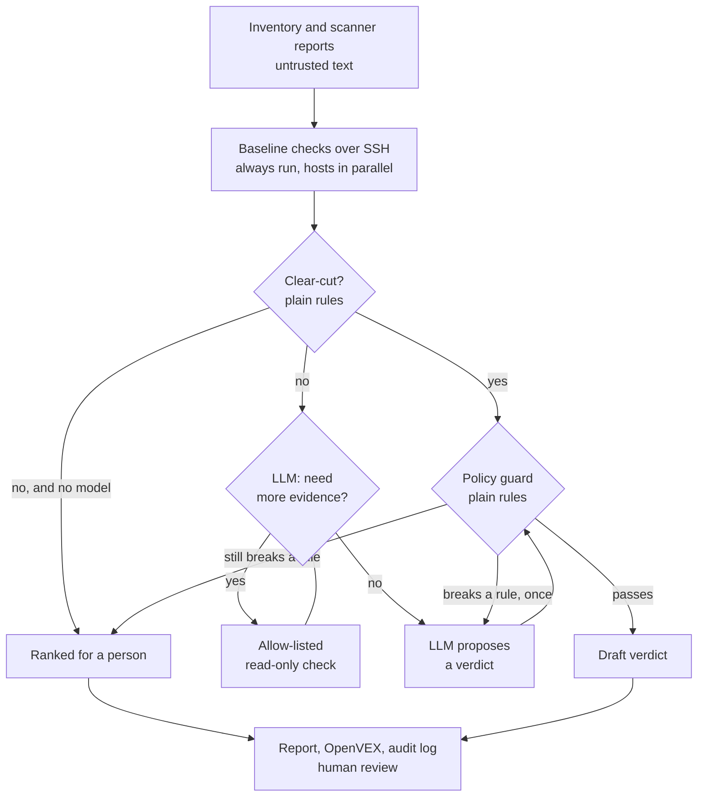

# HostProof

**Don't trust the finding. Verify the host.**

An LLM agent for evidence-driven Linux vulnerability validation, built in Python with LangGraph and Ollama.

A vulnerability scanner reports that a package is installed at a vulnerable version. It usually can't tell you whether that code is running, reachable from the network, or already mitigated, so every finding looks equally urgent.

HostProof is an AI agent that investigates those findings. It takes a scanner report and collects evidence from each Linux host with read-only checks of package inventory, running processes, loaded libraries, enabled services, listening ports and configuration, then sorts findings by real exposure.

Plain code settles the clear-cut findings. For the harder ones, the LLM agent reads the advisory, decides which further evidence to collect, and proposes a verdict that cites that evidence. A deterministic policy guard checks every verdict, and a person reviews the result.

## Tech stack

| Layer | Technology | What it does |
| --- | --- | --- |
| Language | Python 3.11+ | All of the agent and its host checks |
| Agent orchestration | [LangGraph](https://github.com/langchain-ai/langgraph) | Runs the agent as a state machine: plan, collect evidence, decide, guard, retry |
| LLM runtime | [Ollama](https://ollama.com) in its own container, default model `qwen2.5:7b` | Runs the model on a private network, so host data stays with you |
| Structured LLM output | JSON Schema and [Pydantic](https://docs.pydantic.dev) | Constrains and validates what the model returns |
| LLM security | Allow-listed tools, untrusted-data tagging, deterministic policy guard, prompt injection test cases | Limits what a fooled model can do |
| Host evidence | SSH, Python standard library, `/proc`, dpkg and rpm, systemd | Read-only checks that run on the target |
| Deployment | Docker Compose | Runs HostProof and the LLM as separate, hardened containers |
| Input and output | Trivy JSON, [OpenVEX](https://openvex.dev), Markdown, hash-chained JSONL audit log | Fits existing scanner and VEX workflows |
| Supporting libraries | httpx, PyYAML, Rich, pytest | Model API calls, snapshots, terminal output, tests |
| CI security | GitHub Actions, Gitleaks, Semgrep, Trivy, Checkov, plus an advisory AI review agent | Scans every commit |

> **Status: Phase 1.** Real-host test results will be published in [docs/TEST_RESULTS.md](docs/TEST_RESULTS.md).

## The problem

- **Scanners report what's installed, not what's in use.** Sysdig's 2023 report found [only 15% of fixable high and critical vulnerabilities were in packages loaded at runtime](https://cloudsecurityalliance.org/articles/vulnerability-prioritization-combating-developer-fatigue). That's vendor data on containers, so treat it as a sign of the problem rather than a figure for your estate.
- **Teams can't patch everything.** The median enterprise [closes about 15% of its open vulnerabilities a month](https://research.empiricalsecurity.com/research/reality-check).
- **A patched package can still be vulnerable.** After an upgrade, a process keeps running the old code until it restarts. [`needrestart`](https://manpages.ubuntu.com/manpages/noble/man1/needrestart.1.html) finds daemons in this state, but its documentation doesn't describe mapping them to findings.
- **Runtime context usually comes with a platform.** Commercial tools such as [Sysdig](https://docs.sysdig.com/en/docs/sysdig-secure/vulnerabilities/findings/runtime/risk-spotlight) already offer in-use prioritisation. HostProof is aimed at teams who want something small and open to run against their existing Linux hosts and scanner output.

## What you get from one report

| Exposure | What the evidence shows | Typical action |
| --- | --- | --- |
| `network` | Code from the package is listening on a non-loopback address | Fix first |
| `running` | Code is in memory, but only local | Fix soon |
| `local` | Setuid or setgid files that local users could run | Fix soon, especially on shared hosts |
| `unknown` | The evidence is incomplete | Check by hand |
| `enabled` | Not running now, but set to start | Schedule |
| `dormant` | Installed, with nothing running or enabled | Lower priority, or remove |
| `none` | Package isn't installed | Scanner data is stale or wrong |

It connects libraries to what uses them. A finding in a library such as `libssl` shows up as `network` if a listening server has it loaded, because the check follows the library to the process and its ports.

## Quick start

You need Docker with Compose, SSH access to your Linux hosts, and a scanner report for each host. Nothing is installed on the hosts, apart from an optional fixed probe. The LLM runs in its own container.

```bash
cp -r workspace.example workspace
docker compose up -d ollama
docker compose exec ollama ollama pull qwen2.5:7b
# Add your SSH key, known_hosts file, reports and hosts.yaml to workspace/
docker compose run --rm hostproof scan --inventory hosts.yaml --out runs
```

Results appear in `workspace/runs/`: a report, an OpenVEX draft, and an audit log per host.

See [Deployment](docs/DEPLOYMENT.md) for SSH access, least-privilege setup, scale, and running without a model.

Only assess systems you're authorised to assess.

## How it works

See the [architecture guide](docs/ARCHITECTURE.md).



HostProof runs from one place and reaches each host over SSH. It's all Python: the checks run on the target by sending `probe.py`, which uses only the standard library, to the host's own `python3`, or by calling a fixed copy installed there. The LLM is a separate container on a private network. Clear-cut findings are settled without it, and every unresolved finding within the budget goes to it, most exposed first across the whole fleet. If the model is unavailable, those findings stay with a person, and nothing is dismissed.

### Why use an LLM at all?

Most of the ranking needs no AI, and that's deliberate. The LLM handles what can't be hard-coded across tens of thousands of CVEs: reading an advisory, working out which config matters, and judging whether what's on the host answers it. If model results don't justify that, the rules-only mode is still useful, and the evaluation is designed to show which it is.

### Security controls

| Risk | Control | Where |
| --- | --- | --- |
| Prompt injection in advisories, configs or process names | Untrusted text is wrapped in randomly tagged blocks, and the guard checks verdicts against collected evidence | `llm.py`, `guard.py` |
| Model tries to run something dangerous | It can only name a check from an allow-list. It never writes a command | `checks.py`, `agent.py` |
| Argument injection | Strict validation, with no shell involved at any point | `checks.py`, `collectors.py` |
| Reading secrets from a host | Sensitive paths refused, only matching lines returned, key files skipped | `checks.py`, `probe.py` |
| Host data leaving your network | Remote model URLs refused unless you opt in | `llm.py` |
| Model failure or nonsense output | Fails safe to `under_investigation` | `agent.py` |
| Disputed decisions later | Hash-chained audit log of every check and decision | `audit.py` |
| Over-reliance on automation | Every verdict is a draft that needs human review | `outputs.py` |

Full details are in the [threat model](docs/THREAT_MODEL.md).

## Testing

Automated tests cover the guard, the allow-list, the probe on a live host, and prompt injection attempts using simulated hostile models. `tests/fixtures/` holds synthetic regression data for those tests. Real-host and real-model results belong in [docs/TEST_RESULTS.md](docs/TEST_RESULTS.md).

## Secure by design

Every push and pull request runs [this workflow](.github/workflows/security.yml):

| Stage | Tool | Blocks the merge? |
| --- | --- | --- |
| Secrets | Gitleaks | Yes |
| SAST | Semgrep | Yes |
| SCA | Trivy, using hash-locked dependencies | Yes |
| IaC | Checkov (Dockerfile and GitHub Actions) | Yes |
| Guard and injection tests | pytest | Yes |
| AI review of findings | Local Ollama model | **No, advice only** |

The AI agent comments on findings, but it can't waive a failure. Scanner output can contain attacker-controlled text, so a fooled model must only be able to produce a wrong comment, never a passing build. Make `Security gate` a required check in your branch protection rules to enforce this.

Actions are pinned to commit hashes, and jobs use least-privilege tokens. That matters here: [`trivy-action` tags were hijacked in March 2026](https://github.com/aquasecurity/trivy/security/advisories/GHSA-69fq-xp46-6x23).

## Limitations

- **Platforms:** the probe's Debian and Ubuntu paths are the primary target. RPM version comparison isn't implemented yet, so verdicts there stay cautious.
- **Mitigation claims:** the guard confirms a cited config line exists, not that it's effective. A fooled model could cite a harmless line, and [a test documents this](tests/test_guard.py). It's the main reason human review is mandatory.
- **Idle isn't safe:** only a disabled service can be called "not in execute path". Commands and libraries can start or load at any moment, so they're ranked `dormant` instead of being dismissed.
- **Host-level view:** there's no firewall or network path analysis yet, so `network` means listening, not proven reachable.
- **Needs SSH, Python and root:** a target needs `python3`, and without root, results are incomplete. A host without SSH needs local installation instead. An unreachable host is reported, and nothing about it is dismissed.
- **A compromised host can lie:** this is prioritisation, not forensics.

## Roadmap

See the [roadmap](docs/ROADMAP.md). Phase 2 adds approval-gated Ansible remediation, Phase 3 adds CMDB and ServiceNow, and Phase 4 extends to containers, Kubernetes and enterprise AI platforms.

## Documentation

- [Architecture guide](docs/ARCHITECTURE.md)
- [Deployment](docs/DEPLOYMENT.md)
- [Test results](docs/TEST_RESULTS.md)
- [Threat model](docs/THREAT_MODEL.md)
- [Roadmap](docs/ROADMAP.md)

## Disclaimer

A personal project. Not affiliated with any employer. It only reads from the hosts it assesses. Verdicts are drafts and aren't a substitute for professional judgment.

Licensed under [Apache-2.0](LICENSE).
