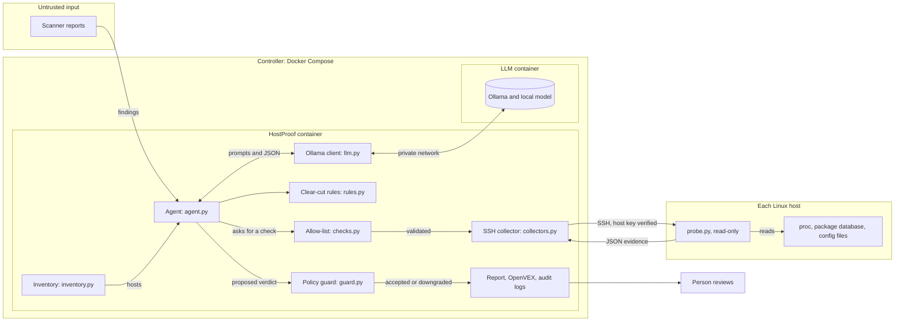
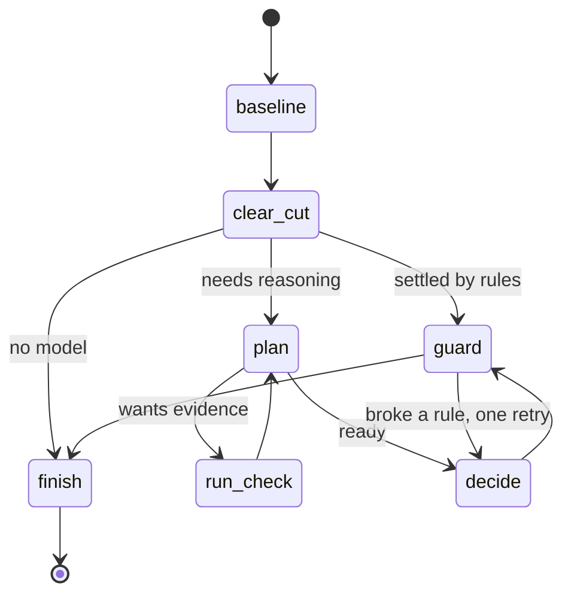

# Architecture

HostProof is an LLM agent, built with LangGraph and Ollama, that tests scanner findings against what's really happening on a host.

## The parts

## The agent's flow

## Who decides what

| Decision | Made by | Can the model change it? |
| --- | --- | --- |
| Which checks exist | `checks.py` | No |
| Baseline facts | `probe.py` | No |
| Exposure ranking | `rules.py` | No |
| Clear-cut verdicts | `rules.py` | No |
| Which extra check to run | Model, within the allow-list | Yes, within limits |
| Harder verdicts | Model proposes, guard checks | Only if the evidence allows it |
| Final action | A person | No |

## The trust boundaries

1. **Scanner report to agent:** advisory text can contain prompt injection, so it's length-limited and tagged as data.
2. **Model to agent:** model output is untrusted, so requests go through the allow-list and verdicts go through the guard.
3. **Agent to host:** only four read-only checks exist. Arguments are validated on both sides, and SSH host keys are always verified.
4. **Host to agent:** a host's data is treated as untrusted too. A compromised host can lie, so this is prioritisation rather than forensics.
5. **Agent to report:** untrusted text is sanitised before it's written to Markdown.
